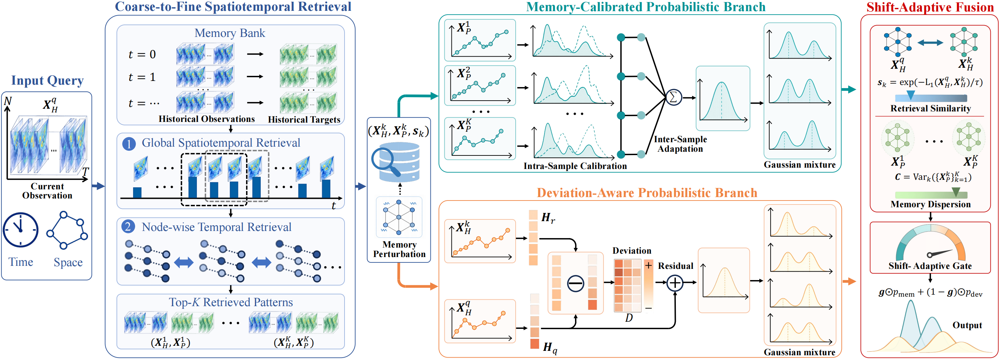

# REMIND

## Model overview



## Installation

Use Python 3.10 or newer. Install a PyTorch build compatible with your machine
and CUDA environment, then install the remaining dependencies:

```bash
pip install -r requirements.txt
```

## Data

Download the processed datasets from
[Zenodo (DOI: 10.5281/zenodo.23559180)](https://doi.org/10.5281/zenodo.23559180).
Download the ZIP archive for each dataset you want to use and extract it into
`data/` (for example, `unzip CAMELS.zip -d data/` from the repository root).
Each archive already contains its dataset directory.

Place the datasets under `data/ENERGY`, `data/CAMELS`, `data/PEMS`, or
`data/PEMS-7years`. Data files, checkpoints and generated outputs are excluded
from version control. See [data/README.md](data/README.md) for dataset layouts.

Each directory requires:

- `adj.npy`: an N × N adjacency matrix, ordered consistently with the data columns.
- One or more numeric `.npy` time-series arrays with shape T × N.
  Files are ordered by the first number in their filenames.

Do not place unrelated `.npy` files inside a dataset directory. Preprocessing
creates train/validation/test windows and normalization metadata; retrieval creates
FAISS and node-retrieval caches in the same directory. Existing preprocessing is
reused, so use a fresh directory when changing raw data or window settings.

## Run

Run commands from this project root. 
```bash
bash scripts/train_pems-7years.sh --dry-run
bash scripts/train_pems-7years.sh --prepare
DEVICE_INDEX=0 bash scripts/train_pems-7years.sh
```

`--prepare` rebuilds retrieval caches. An external data directory can be supplied
with `DATA_DIR`; its final directory name must match a supported dataset name.
For a terminal-independent background run:

```bash
mkdir -p background_logs
nohup bash -c 'bash scripts/train_pems-7years.sh --prepare && exec bash scripts/train_pems-7years.sh' > background_logs/pems-7years.log 2>&1 < /dev/null &
```

To evaluate a saved checkpoint without training:

```bash
bash scripts/evaluate_metrics.sh pems-7years /path/to/model.pt
```


## Source layout

- `algorithm/`: active model, losses, training and probabilistic evaluation.
- `utils/common_utils.py`: filesystem/logging helpers and retrieval similarity transform.
- `utils/metric.py`: MAE, RMSE and MAPE helpers. CRPS/ES live in `algorithm/probabilistic_metrics.py`.

Console output retains the run location, phase progress, saved files, epoch metrics,
early stopping and final test metrics. Full configuration is retained in the run log.

## Data sources and references

The packaged arrays are processed subsets used for REMIND experiments, rather
than complete, unmodified releases of the source datasets. Please cite the
corresponding source publications when using these data.

- **ENERGY**: the Energy-Stream benchmark described in Expand and Compress [1].
- **PEMS / PEMS-7years**: the traffic-data lineage of TrafficStream [2] and the
  PEMS-Stream benchmark described in Expand and Compress [1].
- **CAMELS**: the CAMELS dataset described by Addor et al. [3].

1. Wei Chen and Yuxuan Liang. “Expand and Compress: Exploring Tuning Principles for Continual Spatio-Temporal Graph Forecasting.” ICLR, 2025. [Paper](https://proceedings.iclr.cc/paper_files/paper/2025/file/cb2266111eadcfa2c02187ace64e2183-Paper-Conference.pdf).
2. Xu Chen, Junshan Wang, and Kunqing Xie. “TrafficStream: A Streaming Traffic Flow Forecasting Framework Based on Graph Neural Networks and Continual Learning.” IJCAI, pp. 3620–3626, 2021. [DOI](https://doi.org/10.24963/ijcai.2021/498).
3. Nans Addor, Andrew J. Newman, Naoki Mizukami, and Martyn P. Clark. “The CAMELS data set: catchment attributes and meteorology for large-sample studies.” Hydrology and Earth System Sciences, 21(10):5293–5313, 2017. [DOI](https://doi.org/10.5194/hess-21-5293-2017).
